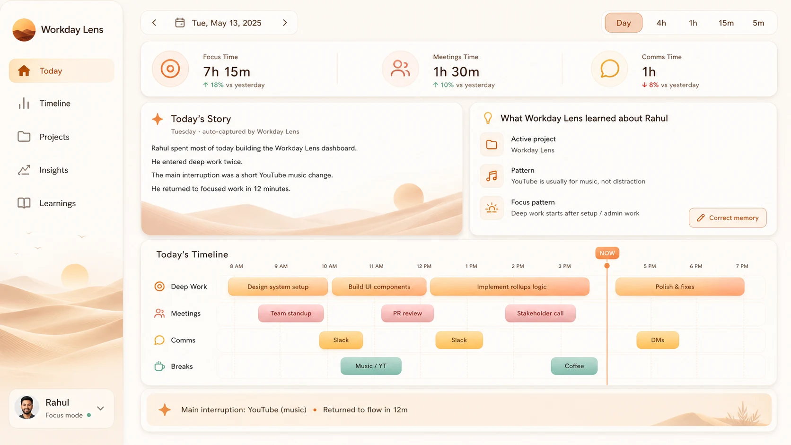
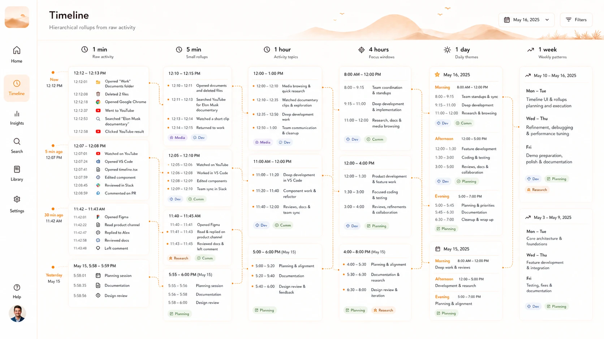
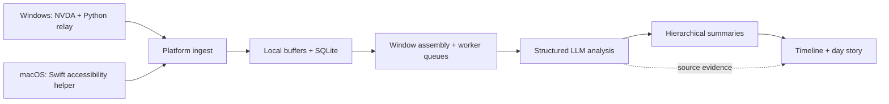

# Workday Lens

**A private memory of your workday.**

Turn a day of desktop activity into a timeline you can understand. Workday Lens by Navya AI follows the context of your work across apps, documents, browsers and meetings, then turns it into clear insights: what you worked on, where your focus went, and how the day unfolded.

That history becomes a lasting, structured memory on your machine, from short activity windows to daily and weekly summaries. It is also a foundation for giving your AI agents useful work context. Developers can retrieve summaries through the local API today; dedicated agent connectors are on the [roadmap](docs/roadmap.md#memory-for-your-agents). [Explore the agent-memory direction →](docs/agent-memory.md)

[Windows beta download](https://navya.ai/download) · [Try the demo](#try-it-with-synthetic-data) · [Model support](#model-support) · [Evaluation](docs/evaluation.md) · [Architecture](docs/architecture.md)

*Interface previews from [navya.ai](https://navya.ai). These illustrate the product design; available features and appearance vary by platform/version. [Running-app screenshots](docs/interface-preview.md) show the current source demo.*

### Daily dashboard



### Detailed timeline



*The evaluation below contains real aggregate benchmark results. Private work history is not published.*

[](https://github.com/rahulmeena/workday-lens/actions/workflows/ci.yml)

## Evaluation

Development included **46 model/runtime/modality/prompt configurations across 25 local/open-weight and 4 proprietary model identities**, spanning quantized local models, text/image inputs and hierarchical summaries. The saved archive contains **27,666 generation records** and **55,878 completed LLM judgments**: 33,981 quality judgments plus 21,897 exploratory workflow-opportunity assessments.

The evaluation workflow combines GPT-5.4/GPT-5.5/GPT-5.4-mini judges, reference agreement, source-grounded faithfulness/coverage/precision, schema validity, latency and token-use tracking. Four retained 50-card prompt sweeps show how prompt changes were compared, including regressions.


All **16 configurations** from the source-grounded evaluation appear together, sorted by recorded mean overall score from highest to lowest. The bars show faithfulness and coverage, with sample counts beside each row.

**[Open-weight vs. proprietary results →](docs/evaluation-comparison.md)** · [Evaluation methods](docs/evaluation.md) · [All model results](docs/evaluation-models.md) · [Judge scores](docs/evaluation-judges.md) · [Prompt experiments](docs/evaluation-prompts.md) · [Data and code](evaluations/README.md)

*These are retrospective development results with uneven coverage, not a controlled leaderboard. Counts include failed generation configurations; 24 of the 25 local model identities produced successful outputs. Repeated judgments cover 589 distinct source buckets, not 55,878 independent examples. The report distinguishes measured quality, heuristics and unavailable metrics.*

## What it does

- **Reconstructs context:** turns accessibility events and application metadata into structured activity descriptions, goals, projects, and next steps.
- **Summarizes at multiple scales:** builds from short windows to 5-minute, 15-minute, hourly, daily, and weekly summaries on the development branch.
- **Makes results inspectable:** drill into the timeline, source excerpts, model responses, token usage, and latency.
- **Builds reusable work context:** keeps structured summaries, goals, projects and their time ranges accessible through a local API for developer-built agent workflows.
- **Supports local inference:** the macOS development version can run Qwen through llama.cpp; a configured OpenAI provider is also available.
- **Keeps you in control:** local capture buffers, local storage, pause/resume, and optional screenshots disabled by default on macOS.

This is a personal activity tool. It infers context from incomplete evidence; its summaries are not an authoritative record of productivity. It does not autonomously operate your desktop.

## Memory for your agents

Your work does not begin when you open a chat. Workday Lens preserves the context around it: the project you were working on, the task you returned to, and the details behind a daily summary. The aim is to let the agents you choose start with that context instead of asking you to reconstruct it each time.

Today, developers can use the local API to retrieve selected summaries and inspect their underlying activity. Ready-made connectors for assistants such as Claude and Codex, portable context exports, and controls for scoped sharing are planned. [Current API and integration roadmap →](docs/agent-memory.md)

## Platform status

| Version | Status | Source / instructions |
| --- | --- | --- |
| Windows beta | Available to download; installed and tested by the maintainer on a Windows machine | [Download](https://navya.ai/download) · [`windows-beta`](https://github.com/rahulmeena/workday-lens/tree/windows-beta) |
| Windows ARM64 | Separate packaging implementation; requires native ARM64 tooling | [`windows-arm64-beta`](https://github.com/rahulmeena/workday-lens/tree/windows-arm64-beta) |
| macOS | Development version used and verified by the maintainer; no public installer yet | `main` · [Run from source](docs/development.md) |

The platform versions currently use separate source branches. `main` contains the newer macOS capture pipeline, hierarchical timeline, local Qwen integration, and resource monitor. These features are **not all present in the downloadable Windows beta**. See [versions and provenance](docs/versions.md) before building or reporting an issue.

## Model support

The project is open source; the inference provider depends on the version you run. **Evaluating a model does not mean it is integrated into the desktop app.**

| Version / workflow | Real inference available today | Maturity |
| --- | --- | --- |
| Windows beta source (`windows-beta`, `windows-arm64-beta`) | OpenAI API with your own API key | Existing beta implementation; no local-model provider in these branches |
| macOS development (`main`) | OpenAI API **or local Qwen3.5-4B Q4_K_M via llama.cpp** | Local integration exists; source setup and validation required; no public macOS installer |
| Evaluation harness | 25 local/open-weight and 4 proprietary model identities investigated | Research coverage; not a list of supported app providers |
| Synthetic demo | No model or API key required | Deterministic sample output, not real inference |

Local Qwen handles activity windows, hierarchical summaries and day stories; Gantt ranking/composition currently use deterministic fallbacks in local mode. Broader local-model choice, Windows local inference, and packaged setup are [roadmap work](docs/roadmap.md#inference-and-model-choice). [Provider details and code references →](docs/model-support.md)

## Try it with synthetic data

Explore the actual dashboard without enabling capture, downloading a model, or entering an API key. Requires **Python 3.12** and **Node.js 22**.

```bash
git clone https://github.com/rahulmeena/workday-lens.git
cd workday-lens
python3 -m venv .venv
source .venv/bin/activate
python -m pip install -r backend/requirements.txt
python scripts/demo.py
```

In a second terminal:

```bash
cd workday-lens/frontend
cp .env.demo.example .env.local  # for a fresh clone
npm ci
npm run dev -- --hostname 127.0.0.1
```

Open **http://127.0.0.1:3000**. The demo backend uses port **8010**. If you already have `frontend/.env.local`, update only `NEXT_PUBLIC_API_BASE_URL` instead of overwriting the file.

The demo uses a separate `.demo-data/` directory and never starts native capture. It demonstrates the UI and data flow with fictional summaries, not model accuracy. [Full setup →](docs/development.md)

## How it works



*The diagram describes the two implementations. The hierarchy and local Qwen path are in `main`; Windows beta uses its earlier analysis pipeline.*

The engineering focus is turning noisy, continuous desktop observations into useful context with bounded prompts, background processing, recoverable queues, and inspectable evidence. The [architecture guide](docs/architecture.md) explains the implementation and tradeoffs.

| Layer | Implementation |
| --- | --- |
| Native capture | Swift, AppKit, Accessibility APIs, CGEventTap; NVDA/Python on Windows |
| Backend | Python, FastAPI, Pydantic, SQLAlchemy, SQLite |
| Inference | Structured prompts, OpenAI API, local Qwen via llama.cpp |
| Frontend | TypeScript, React, Next.js, TanStack Query |
| Distribution | Windows launcher, PyInstaller, Inno Setup; macOS packaging planned |

## Privacy and limitations

**Local storage does not mean every inference mode is offline.** With the OpenAI provider enabled, captured text and selected contextual summaries are sent to OpenAI using your API key. Local Qwen keeps inference on the machine after runtime/model downloads. The demo uses no inference service.

Accessibility text can contain sensitive information. Redaction is best effort. The local API has no user authentication and must remain bound to loopback. Read [privacy and data handling](docs/privacy.md) before enabling capture. Never post real activity logs, screenshots, databases, or keys in issues.

## Development

```bash
python -m pytest backend/tests -q
cd frontend
npm run lint
npm run typecheck
npm run build
# On macOS, from the repository root:
swift build --package-path macos/WorkdayLensCapture
```

[Development guide](docs/development.md) · [Roadmap](docs/roadmap.md) · [Security policy](SECURITY.md) · [Third-party notices](THIRD_PARTY_NOTICES.md)

## About

Built by [Rahul Meena](https://github.com/rahulmeena). Workday Lens began as a closed-source project and is being developed in the open from this public source snapshot. [navya.ai](https://navya.ai) hosts the product introduction and Windows beta download.

Licensed under **GNU GPL v3.0**. See [LICENSE](LICENSE) and [third-party notices](THIRD_PARTY_NOTICES.md); upstream components retain their own copyright and license notices.
