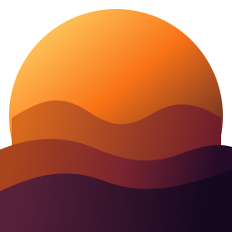
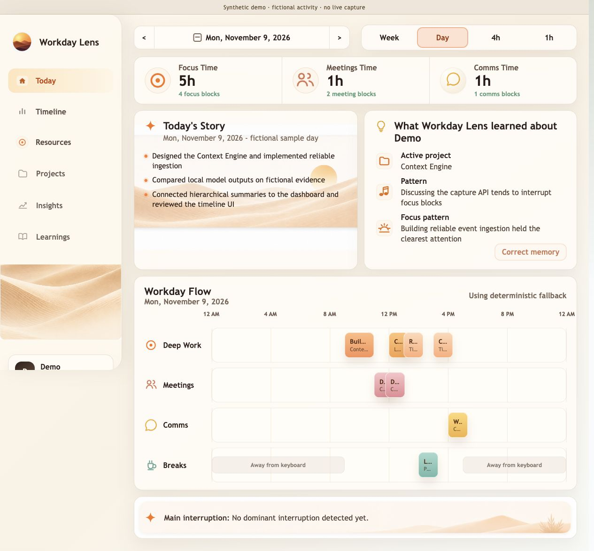
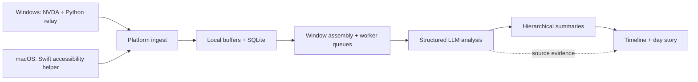

<p align="center"></p>

# Workday Lens

**Turn a day of desktop activity into a timeline you can understand.**

Workday Lens captures desktop context, groups it into activity windows, and uses language models to reconstruct what you worked on, why, and how the day unfolded. It combines native capture, local storage, hierarchical summaries, and an interactive timeline.

[Windows beta download](https://navya.ai/download) · [Try the demo](#try-it-with-synthetic-data) · [Architecture](docs/architecture.md) · [Privacy](docs/privacy.md) · [Contributing](CONTRIBUTING.md)



*This dashboard uses fictional activity. No personal work history is included in the repository.*

[](https://github.com/rahulmeena/workday-lens/actions/workflows/ci.yml)

## What it does

- **Reconstructs context:** turns accessibility events and application metadata into structured activity descriptions, goals, projects, and next steps.
- **Summarizes at multiple scales:** builds from short windows to 5-minute, 15-minute, hourly, daily, and weekly summaries on the development branch.
- **Makes results inspectable:** drill into the timeline, source excerpts, model responses, token usage, and latency.
- **Supports local inference:** the macOS development version can run Qwen through llama.cpp; a configured OpenAI provider is also available.
- **Keeps you in control:** local capture buffers, local storage, pause/resume, and optional screenshots disabled by default on macOS.

This is a personal activity tool. It infers context from incomplete evidence; its summaries are not an authoritative record of productivity. It does not autonomously operate your desktop.

## Platform status

| Version | Status | Source / instructions |
| --- | --- | --- |
| Windows beta | Available to download; installed and tested by the maintainer on a Windows machine | [Download](https://navya.ai/download) · [`windows-beta`](https://github.com/rahulmeena/workday-lens/tree/windows-beta) |
| Windows ARM64 | Separate packaging implementation; requires native ARM64 tooling | [`windows-arm64-beta`](https://github.com/rahulmeena/workday-lens/tree/windows-arm64-beta) |
| macOS | Development version used and verified by the maintainer; no public installer yet | `main` · [Run from source](docs/development.md) |

The platform versions currently use separate source branches. `main` contains the newer macOS capture pipeline, hierarchical timeline, local Qwen integration, and resource monitor. These features are **not all present in the downloadable Windows beta**. See [versions and provenance](docs/versions.md) before building or reporting an issue.

## Try it with synthetic data

Explore the actual dashboard without enabling capture, downloading a model, or entering an API key. Requires **Python 3.12** and **Node.js 22**.

```bash
git clone https://github.com/rahulmeena/workday-lens.git
cd workday-lens
python3 -m venv .venv
source .venv/bin/activate
python -m pip install -r backend/requirements.txt
python scripts/demo.py
```

In a second terminal:

```bash
cd workday-lens/frontend
cp .env.demo.example .env.local  # for a fresh clone
npm ci
npm run dev -- --hostname 127.0.0.1
```

Open **http://127.0.0.1:3000**. The demo backend uses port **8010**. If you already have `frontend/.env.local`, update only `NEXT_PUBLIC_API_BASE_URL` instead of overwriting the file.

The demo uses a separate `.demo-data/` directory and never starts native capture. It demonstrates the UI and data flow with fictional summaries, not model accuracy. [Full setup →](docs/development.md)

## How it works



*The diagram describes the two implementations. The hierarchy and local Qwen path are in `main`; Windows beta uses its earlier analysis pipeline.*

The engineering focus is turning noisy, continuous desktop observations into useful context with bounded prompts, background processing, recoverable queues, and inspectable evidence. The [architecture guide](docs/architecture.md) explains the implementation and tradeoffs.

| Layer | Implementation |
| --- | --- |
| Native capture | Swift, AppKit, Accessibility APIs, CGEventTap; NVDA/Python on Windows |
| Backend | Python, FastAPI, Pydantic, SQLAlchemy, SQLite |
| Inference | Structured prompts, OpenAI API, local Qwen via llama.cpp |
| Frontend | TypeScript, React, Next.js, TanStack Query |
| Distribution | Windows launcher, PyInstaller, Inno Setup; macOS packaging planned |

## Privacy and limitations

**Local storage does not mean every inference mode is offline.** With the OpenAI provider enabled, captured text and selected contextual summaries are sent to OpenAI using your API key. Local Qwen keeps inference on the machine after runtime/model downloads. The demo uses no inference service.

Accessibility text can contain sensitive information. Redaction is best effort. The local API has no user authentication and must remain bound to loopback. Read [privacy and data handling](docs/privacy.md) before enabling capture. Never post real activity logs, screenshots, databases, or keys in issues.

## Development

```bash
python -m pytest backend/tests -q
cd frontend
npm run lint
npm run typecheck
npm run build
# On macOS, from the repository root:
swift build --package-path macos/WorkdayLensCapture
```

[Development guide](docs/development.md) · [Roadmap](docs/roadmap.md) · [Security policy](SECURITY.md) · [Third-party notices](THIRD_PARTY_NOTICES.md)

## About

Built by [Rahul Meena](https://github.com/rahulmeena). Workday Lens began as a closed-source project and is being developed in the open from this public source snapshot. [navya.ai](https://navya.ai) hosts the product introduction and Windows beta download.

Licensed under **GNU GPL v3.0**. See [LICENSE](LICENSE) and [third-party notices](THIRD_PARTY_NOTICES.md); upstream components retain their own copyright and license notices.
