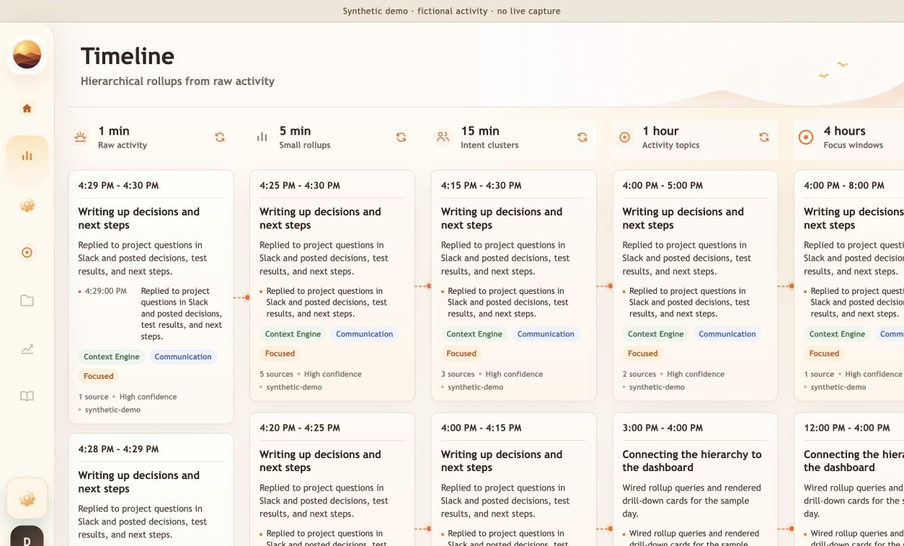

# Architecture

Workday Lens reconstructs a user's day from desktop context. Capture, persistence, inference, aggregation, and presentation are separate so slow model calls do not sit on the input-event path.

## Native capture and buffering

The [Swift menu-bar helper](../macos/WorkdayLensCapture/Sources/WorkdayLensCapture/main.swift) combines Accessibility notifications with conservative polling. It records application/window context, changed accessibility text, mouse actions, semantic gestures, and system-state events. Command-key metadata and keyboard-activity classes are separate from ordinary typed characters. Sensitive roles/applications have best-effort redaction.

Events use `workday_lens_capture_event.v1`, with timestamps and a platform source. A local JSONL retry buffer handles short backend outages without blocking capture. Pause/resume and permission status live in the menu bar.

Windows beta uses a modified NVDA Speech Logger add-on and Python relay/uploader, on the Windows branches. It uses the earlier message-ingest API. The platform implementations have not yet been unified into one distribution.

## Ingest and activity windows

The [capture endpoint](../backend/app/api/v1/endpoints/capture.py) validates events. The [capture service](../backend/app/services/capture.py) converts them to compact transcript lines; screenshot paths are stripped from text inference input. The [window assembler](../backend/app/services/window.py) groups messages into duration/token-bounded windows.

SQLite retains source messages, windows, model runs, rollups, and cached Gantt compositions. Keeping source evidence enables inspection, while making retention and file protection important.

## Asynchronous analysis

The [workers](../backend/app/worker.py) process window and rollup queues independently. Jobs move through queued, processing, processed, and pending states. Startup requeues interrupted work from persisted state. Retries are bounded by runtime settings.

The [LLM service](../backend/app/services/llm.py) compacts repetitive input and requests structured activity, goal, project, focus, next-step, confidence, and evidence fields. [Normalization](../backend/app/services/analysis.py) constrains categories and supplies defaults for incomplete output.

Provider choices on `main`:

- OpenAI: configured model/key; captured text leaves the machine.
- Local Qwen: [llama.cpp orchestration](../backend/app/services/local_qwen.py), context sizing, structured output, and completion timings.
- Fake mode: deterministic offline behavior for tests/demo; not evidence of model quality.

## Hierarchical context

```text
source messages
  → short windows
  → 5 minute → 15 minute → 1 hour → 4 hour → day → week
```

The [rollup builder](../backend/app/services/rollup.py) checks child readiness and queues parent summaries. Higher levels reuse existing summaries rather than repeatedly submitting an entire raw day. Reprocessing invalidates affected parents.

This reduces repeated input and supports multiple zoom levels, but omissions can propagate upward. Child links and raw evidence make that tradeoff inspectable. Confidence fields are model heuristics, not calibrated accuracy estimates.

## Timeline and observability

The [Gantt service](../backend/app/services/gantt.py) composes display blocks from rollups, caches them using source signatures, and falls back to a deterministic composer on errors/timeouts. The dashboard renders deep work, meetings, communication, and break lanes. The hierarchy exposes underlying summaries.

The macOS resource monitor reports process usage, queue backlog, and Qwen throughput. Debug views expose prompts, responses, token counts, and latency. These views can contain captured content and should remain local.



*Sample data in the running development UI; not a model-quality benchmark.*

## Boundaries

- Single-user SQLite app; no multi-user authorization or public-server deployment.
- Capture quality depends on each application's accessibility support.
- Event IDs exist, but exactly-once delivery across upload retries is not guaranteed.
- Historical evaluation aggregates are [published](evaluation.md); a public held-out benchmark and downstream agent-memory evaluation remain planned.
- Inference and summarization only; no autonomous desktop actions.
- Platform convergence, retention controls, macOS distribution, and broader tests remain roadmap work.
