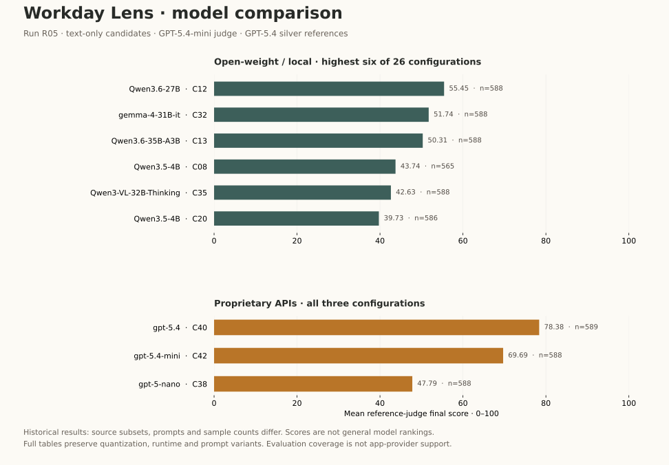

# Open-weight and proprietary model comparison

[Evaluation methods](evaluation.md) · [All judge cohorts](evaluation-judges.md) · [Runtime metrics](evaluation-models.md) · [Application model support](model-support.md)

This view separates **open-weight/local candidates** from **proprietary API candidates** using the same recorded run (**R05**), reference rubric, **GPT-5.4-mini judge**, and **text-only candidate modality**. All 29 matching configurations are listed: 26 local and 3 proprietary. Rows are sorted by recorded mean final score within each group. The figure shows the first six local rows and all three proprietary rows.

**“Highest recorded score” applies only to this historical comparison.** Source subsets, sample counts, hierarchy mix and prompt/runtime settings still differ; this is not a matched-input experiment or a general model leaderboard. The score measures agreement with GPT-5.4-generated references, not human-validated accuracy. GPT-5.4 is also the reference family, and GPT-5.4-mini is both judge and a candidate, so model-family/self-preference bias is possible.

The GPT-5.4 text+image self-reference control is excluded by the text-only filter. GPT-5.4-nano was evaluated in other runs, but has no quality result in this particular R05 comparison; it is not silently assigned a score from a different judge. See [every run](evaluation-judges.md).

`Final` is the recorded mean on the original 0–100 scale. Other quality scores use 0–1. `N` counts successful judgments, not independent examples. No confidence intervals or significance claims are made. Quantization, runtime and prompt variants are preserved below; “open-weight” does not imply identical model licenses.

## Open-weight / local models

Highest recorded mean: **Qwen3.6-27B-MTP-Q4_K_M-Q8nextn-GGUF:Q4_K_M · text**, **55.45/100**, N = 588.

| ID | Configuration | N | Failed | Final | Faithful | Coverage | Precision | Useful | Noise |
| --- | --- | --- | --- | --- | --- | --- | --- | --- | --- |
| C12 | Qwen3.6-27B-MTP-Q4_K_M-Q8nextn-GGUF:Q4_K_M · text | 588 | 0 | 55.45 | 0.58 | 0.50 | 0.64 | 0.56 | 0.24 |
| C32 | gemma-4-31B-it-OptiQ-4bit · text | 588 | 0 | 51.74 | 0.58 | 0.46 | 0.62 | 0.50 | 0.25 |
| C13 | Qwen3.6-35B-A3B-MTP-IMAT-Q4_K_M-Q8nextn-GGUF:Q4_K_M · text | 588 | 0 | 50.31 | 0.53 | 0.46 | 0.60 | 0.50 | 0.27 |
| C08 | Qwen3.5-4B-Q4_K_M+generic_v8 · text | 565 | 0 | 43.74 | 0.45 | 0.40 | 0.53 | 0.44 | 0.31 |
| C35 | Qwen3-VL-32B-Thinking-5bit · text | 588 | 0 | 42.63 | 0.48 | 0.38 | 0.55 | 0.42 | 0.31 |
| C20 | Qwen3.5-4B-GGUF:Q4_K_M · text | 586 | 0 | 39.73 | 0.41 | 0.37 | 0.50 | 0.40 | 0.35 |
| C37 | Qwen3-VL-8B-Instruct-8bit · text | 587 | 0 | 37.86 | 0.44 | 0.33 | 0.51 | 0.37 | 0.34 |
| C22 | Qwen3.5-9B-GGUF:UD-IQ2_M · text | 588 | 0 | 35.80 | 0.37 | 0.33 | 0.47 | 0.36 | 0.36 |
| C34 | Holo2-8B-bf16 · text | 588 | 0 | 35.27 | 0.38 | 0.30 | 0.47 | 0.35 | 0.38 |
| C06 | Qwen3-VL-2B-Instruct-GGUF:Q4_K_M · text | 91 | 0 | 32.24 | 0.34 | 0.28 | 0.43 | 0.32 | 0.42 |
| C04 | Qwen3-4B-GGUF:Q4_K_M · text | 588 | 0 | 32.02 | 0.34 | 0.28 | 0.43 | 0.32 | 0.42 |
| C10 | Qwen2.5-VL-3B-Instruct-GGUF:Q4_K_M · text | 82 | 0 | 27.30 | 0.29 | 0.23 | 0.36 | 0.27 | 0.50 |
| C19 | Qwen3.5-0.8B-GGUF:Q4_K_M+generic_prompt_v1 · text | 565 | 0 | 24.93 | 0.26 | 0.22 | 0.34 | 0.25 | 0.51 |
| C09 | Llama-3.2-3B-Instruct-GGUF:Q4_K_M · text | 588 | 0 | 23.62 | 0.31 | 0.19 | 0.38 | 0.22 | 0.45 |
| C03 | Qwen2.5-1.5B-Instruct-GGUF:Q4_K_M · text | 588 | 0 | 20.33 | 0.24 | 0.17 | 0.32 | 0.20 | 0.55 |
| C01 | Qwen3-1.7B-GGUF:Q4_K_M · text | 588 | 0 | 20.30 | 0.26 | 0.17 | 0.34 | 0.19 | 0.51 |
| C31 | LFM2.5-8B-A1B-MLX-8bit · text | 565 | 0 | 18.78 | 0.35 | 0.15 | 0.33 | 0.17 | 0.42 |
| C30 | LFM2.5-350M-MLX-8bit+minimal_summary_v3_repaired · text | 565 | 0 | 14.07 | 0.29 | 0.09 | 0.33 | 0.11 | 0.56 |
| C33 | MiniCPM5-1B-MLX · text | 588 | 0 | 13.43 | 0.13 | 0.13 | 0.18 | 0.13 | 0.75 |
| C17 | Qwen3.5-0.8B-GGUF:Q4_K_M · text | 585 | 0 | 6.64 | 0.13 | 0.05 | 0.12 | 0.05 | 0.61 |
| C16 | Qwen3-0.6B-GGUF:Q4_K_M · text | 588 | 0 | 6.07 | 0.12 | 0.04 | 0.12 | 0.05 | 0.52 |
| C14 | MiniCPM5-1B-GGUF:F16 · text | 565 | 0 | 6.05 | 0.15 | 0.04 | 0.12 | 0.05 | 0.57 |
| C26 | SmolLM2-135M-Instruct-GGUF:Q4_K_M · text | 590 | 0 | 5.39 | 0.13 | 0.04 | 0.12 | 0.04 | 0.72 |
| C28 | gemma-3-270m-it-qat-GGUF:Q4_K_M · text | 574 | 0 | 5.09 | 0.07 | 0.03 | 0.10 | 0.04 | 0.84 |
| C27 | SmolLM2-360M-Instruct-GGUF:Q4_K_M · text | 584 | 0 | 4.71 | 0.05 | 0.04 | 0.09 | 0.04 | 0.86 |
| C02 | Qwen2.5-0.5B-Instruct-GGUF:Q4_K_M · text | 588 | 0 | 4.49 | 0.15 | 0.03 | 0.10 | 0.04 | 0.70 |

## Proprietary API models

Highest recorded mean: **gpt-5.4 · text**, **78.38/100**, N = 589.

| ID | Configuration | N | Failed | Final | Faithful | Coverage | Precision | Useful | Noise |
| --- | --- | --- | --- | --- | --- | --- | --- | --- | --- |
| C40 | gpt-5.4 · text | 589 | 0 | 78.38 | 0.79 | 0.77 | 0.82 | 0.80 | 0.12 |
| C42 | gpt-5.4-mini · text | 588 | 0 | 69.69 | 0.70 | 0.67 | 0.75 | 0.71 | 0.17 |
| C38 | gpt-5-nano · text | 588 | 0 | 47.79 | 0.46 | 0.47 | 0.53 | 0.49 | 0.35 |

## Source-grounded quality is a separate view

The source-grounded run checks claims against captured evidence and reports hallucination rate as well as faithfulness, coverage, precision and usefulness. It covers a different set of 16 configurations, so its values are not merged with this reference comparison. In particular, the newer Qwen3.6 and Gemma 4 configurations above do not have source-grounded results in the retained archive. [Source-grounded report](evaluation.md#source-grounded-results) · [Full score table](evaluation-judges.md#source-grounded--gpt-54-mini--r01).

## From evaluation to deployment

Windows beta currently uses the OpenAI API. macOS development supports OpenAI and local Qwen3.5-4B Q4_K_M with `generic_v8` (C08 in the historical archive). This integration choice is not a claim that Qwen3.5-4B is the highest-scoring candidate. The other evaluated models are research candidates, not interchangeable providers already shipped in the app. [Support matrix](model-support.md) · [Roadmap](roadmap.md#inference-and-model-choice).

Source: [judge aggregates](../evaluations/results/judge-scores.csv), joined by configuration ID to the [model inventory](../evaluations/results/configurations.csv). Regenerate with `python evaluations/build_report.py`; add `--plot` after installing the report dependencies to regenerate the figure.
