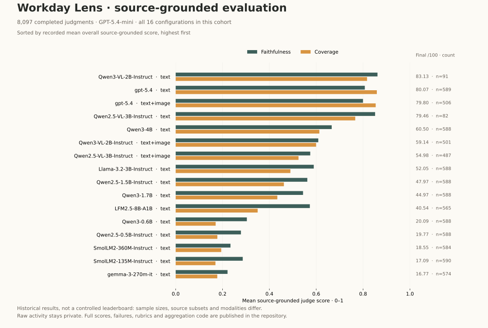

# Evaluation

Workday Lens was developed alongside a model-comparison and prompt-regression workflow. This report publishes **real aggregate results from the saved benchmark database**, collected May 10–July 1, 2026 and exported on November 10, 2026. The product screenshots elsewhere in this repository use synthetic data; these measurements do not.

[All models and runtime](evaluation-models.md) · [All judge scores](evaluation-judges.md) · [Prompt experiments](evaluation-prompts.md) · [Metric definitions](evaluation-metrics.md) · [Data and code](../evaluations/README.md)

| Scope | Verified count | Interpretation |
| --- | ---: | --- |
| Local/open-weight model identities | **25** | Collapses quantization, packaging, runtime and prompt aliases; 24 produced at least one successful generation |
| Proprietary generation models | **4** | GPT-5-nano, GPT-5.4, GPT-5.4-mini, GPT-5.4-nano; GPT-5.5 is an additional judge, not a generation candidate |
| Model/runtime/modality/prompt configurations | **46** | 47 original dashboard rows, with one duplicate HRM local-path alias merged |
| Generation records | **27,666** | 26,654 succeeded, 1,011 failed, 1 queued; includes 6,562 successful teacher/reference generations |
| Completed quality judgments | **33,981** | 25,884 reference-based + 8,097 source-grounded judgments |
| Completed opportunity assessments | **21,897** | Exploratory workflow analysis, separate from quality scoring |
| All completed LLM judgments | **55,878** | Five saved runs; 1,171 additional failed judge records are retained |
| Distinct generations with successful judgments | **20,867** | The same output can be judged by multiple rubrics/models |
| Distinct judged source items | **589** | Overlapping hierarchical buckets, not 55,878 independent examples |
| Stored metric records | **657,942** | 32 metric names, including unmeasured/placeholding fields documented below |

The generation archive covers 3,051 distinct `(level, source_id)` items and 69 sessions containing records. The levels are 1 minute, 5 minutes, 15 minutes, 1 hour, 4 hours, 1 day and 1 week. Model identity means the named model/size/instruction variant, not a claim of identical weights across quantizations. Small smoke runs and failed configurations are visible in the inventory rather than removed.

## Source-grounded results

This cohort asks the judge to check claims against source text/source items and, when available, up to one attached screenshot. It does not use the generated silver label. All 16 configurations in this cohort are plotted; not every generation model received this rubric. **Different rows have different sample sizes and evidence subsets**, so this chart is a record of development results, not a controlled ranking of general model capability.

The [complete judge tables](evaluation-judges.md) include final scores, faithfulness, coverage, precision, usefulness, noise and hallucination rate. The [CSV](../evaluations/results/judge-scores.csv) also includes claim counts and the non-null denominator for each metric.

## Three complementary evaluation views

| View | What it evaluates | Recorded judges | Completed assessments |
| --- | --- | --- | ---: |
| Reference agreement | Candidate summaries against GPT-5.4 silver summaries for matching time buckets | GPT-5.5 first pass: 2,302; GPT-5.4: 4,738; GPT-5.4-mini: 18,844 | 25,884 |
| Source-grounded quality | Supported claims, missing facts, unsupported details and usefulness against captured evidence | GPT-5.4-mini | 8,097 |
| Automation opportunities | Potential delegation, shortcuts and repeated tasks inferred from source evidence and candidate summaries | GPT-5.4-mini, two overlapping cohorts | 21,897 |

The actual per-result judge identity is used in reporting. The first reference run mixed GPT-5.5 and GPT-5.4; it is not described as if one model judged everything. GPT-5.4-mini accounts for most of the judgments.

The original [reference rubric](../evaluations/rubrics/reference.txt) requests a 0–100 final score using 30% silver agreement, 25% coverage, 20% precision, 15% faithfulness and 10% usefulness. The [source-grounded rubric](../evaluations/rubrics/source-grounded.txt) uses 35% faithfulness, 30% coverage, 20% precision and 15% usefulness, with contradiction penalties. These weights are **instructions to the judge**; the exported final score is the recorded judge output, not a newly recomputed formula. Component scores remain available for inspection.

Silver references are machine-generated, not human ground truth. The historical prompt describes an image-backed reference; database links show both GPT-5.4 text+image and text reference outputs, depending on the bucket. GPT-5.4 text+image self-comparisons are explicitly marked as reference controls in the tables.

Automation scores measure inferred opportunity in the observed activity, **not model correctness or realized productivity improvement**. Free-text rationales, source content, behavioral/mental-state inferences and individual activity records are not published.

## Prompt engineering and regression checks

The [prompt experiment report](evaluation-prompts.md) preserves four 50-card sweeps with all tested variants. It includes structured-field agreement, headline/summary similarity, evidence overlap, parsing reliability and output-collapse checks. Each sweep's source-set equality was verified before export.

For example, the Qwen3.5-4B initial sweep records a combined heuristic score of **0.3153** for stored default outputs and **0.3234** for `qwen36_27b_generic_v2`. The later sweep records **0.3374** for `qwen35_4b_generic_v8`. These are tuning-set lexical/structural scores; they do not establish a percentage improvement in semantic accuracy. The tables also show changes that made the score worse.

Full-generation records additionally cover GGUF Q4_K_M / Q5_K_M / UD-IQ2_M, MLX 4/5/8-bit variants, and F16/bf16 configurations across llama.cpp, MLX, MLX-VLM and Transformers. These are stored runtime/model labels; they do not establish a controlled quantization ablation by themselves.

## How to read the metrics

- **Measured operational signals:** generation status, JSON parsing, schema validation, wall-clock latency and recorded token use. A schema-valid output can still be wrong.
- **LLM-judged quality:** faithfulness, coverage, precision, unsupported/contradicted claims, hallucination rate and usefulness. These depend on the rubric, evidence and judge.
- **Agreement proxies:** exact category matches and normalized string similarity to a teacher. They are not semantic accuracy.
- **Self-reported proxies:** confidence and evidence/claim fields emitted by the candidate itself. They are not independent verification.
- **Unavailable/placeholding metrics:** perplexity has no numeric measurements; `timeline_order_score` was hardcoded to 1.0. Neither is presented as demonstrated model quality.

See the [full metric dictionary](evaluation-metrics.md), including hierarchy heuristics and missing-data conventions.

## Limits and next steps

This is a retrospective engineering evaluation on the maintainer's private desktop traces. It is not a public, independently reproducible benchmark. The source dataset contains personal activity, so only aggregate numeric results, counting/aggregation code, schemas and rubrics are public. Anyone can regenerate the report from these CSVs; independently rerunning the historical model calls requires the private evidence and historical runtime environment.

The archive has uneven coverage, overlapping time buckets, repeated source items, variable prompt/runtime settings and unequal image availability. Judge prompts include candidate identity, so the evaluation is not blind. There is no independent human-labeled holdout or confidence-interval claim. Historical latency combines hardware/settings and cannot establish a fair speed ranking. The source-grounded rubric has less model coverage than the reference rubric.

The next evaluation milestone is a shareable synthetic/consented dataset with fixed model configurations, matched inputs, human-calibrated rubrics, blinded judgments and a held-out regression split. The existing archive provides evidence of the development process and its tradeoffs; it is not a substitute for that next step.
