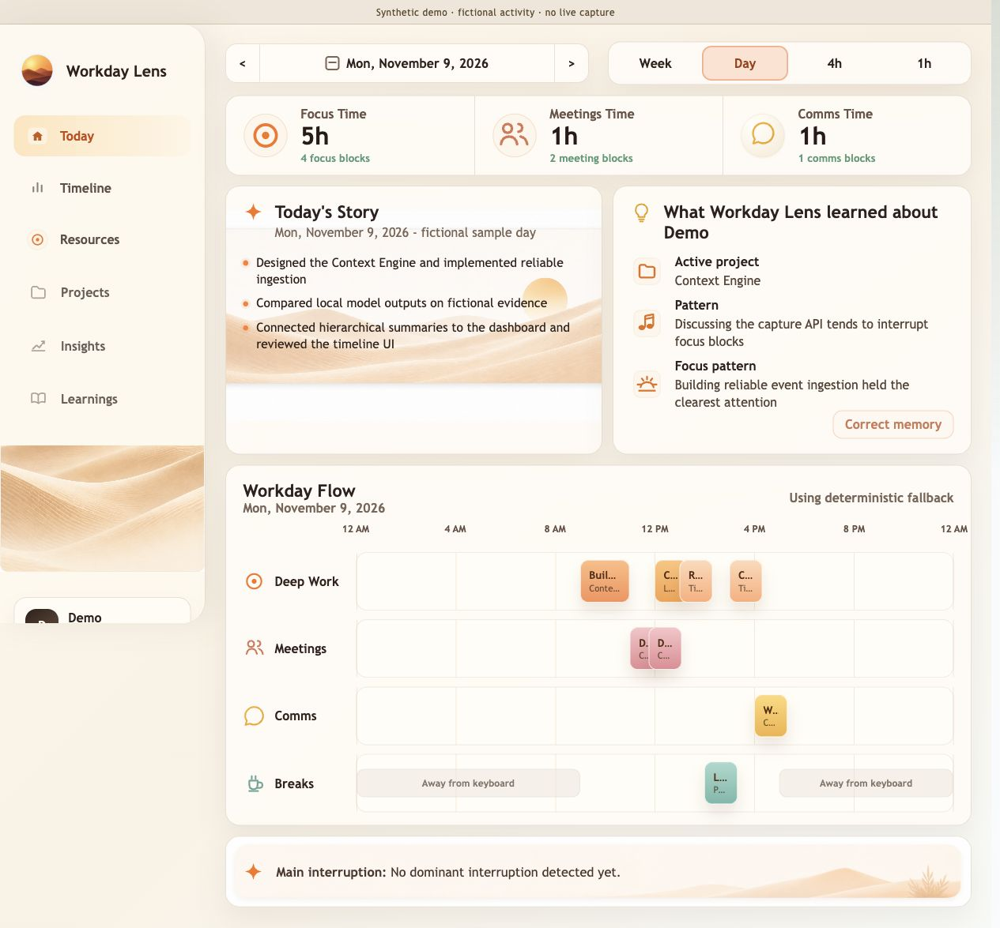
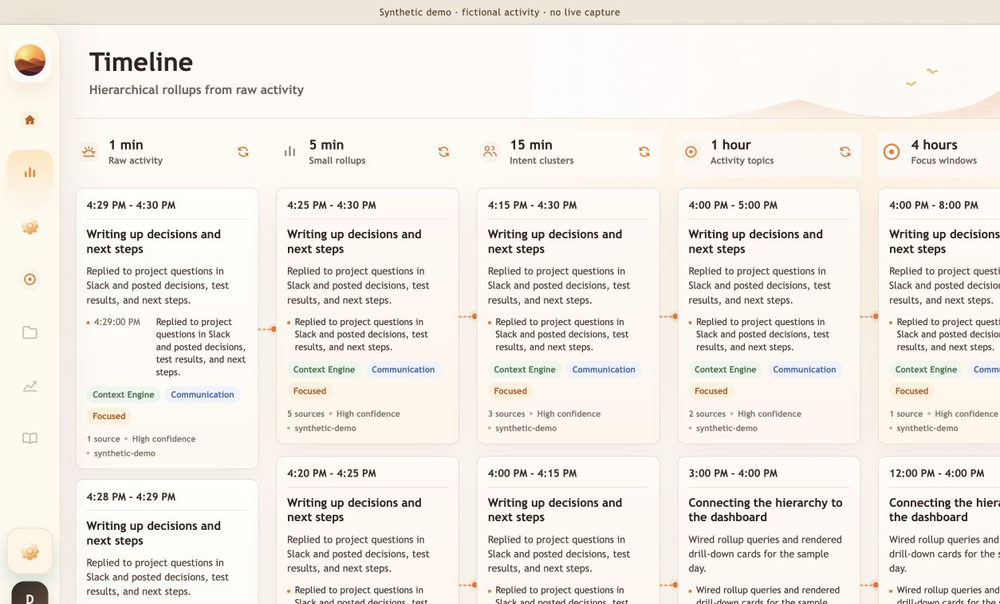

# Interface previews

The README uses the space-themed Navya banner, dashboard and hierarchical activity timeline published on [navya.ai](https://navya.ai). The interface images are website design previews, not a claim that every depicted view or feature is available in both desktop versions.

| Preview | Published asset | Repository copy |
| --- | --- | --- |
| Navya space banner | [hero.webp](https://navya.ai/hero.webp) | [navya-banner.webp](images/navya-banner.webp) |
| Daily dashboard | [today-light.webp](https://navya.ai/today-light.webp) | [navya-dashboard.webp](images/navya-dashboard.webp) |
| Activity timeline | [timeline-light.webp](https://navya.ai/timeline-light.webp) | [navya-timeline.webp](images/navya-timeline.webp) |

Retrieved November 10, 2026 and copied without image edits. The live website uses newer visual assets than the `Navya.ai-website` source snapshot reviewed for this update. The repository copies keep the README independent of future website changes.

## Current running-app demo

These screenshots were captured from the source application using the [synthetic demo](development.md#synthetic-demo). Activity and summaries are fictional; they demonstrate the UI and data flow. They are separate from the real aggregate measurements in the [evaluation report](evaluation.md).

### Daily dashboard

### Hierarchical activity timeline

See [platform/version status](versions.md) and [model support](model-support.md) for what is implemented today.
